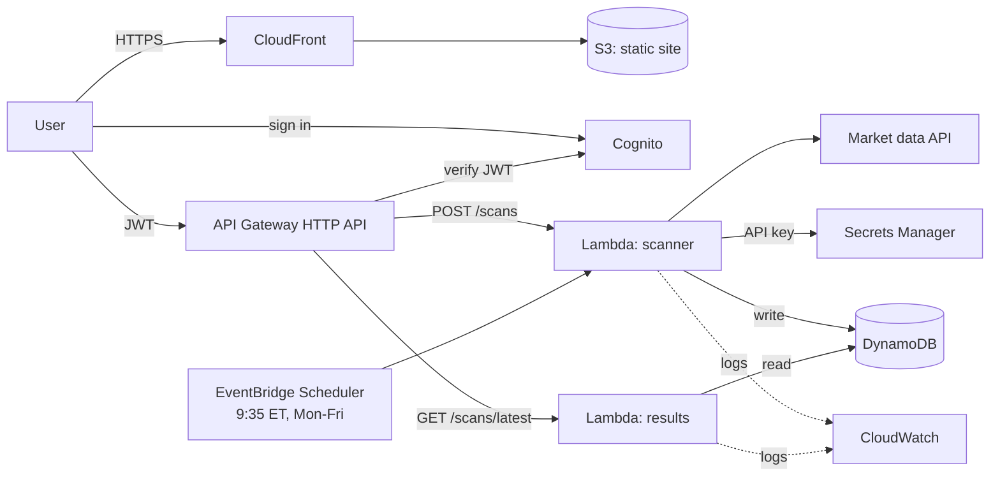

# ProfitX AWS Serverless Stock Scanner

A production-style, fully AWS-native serverless stock scanner built for ProfitX. The system pulls market data from an external API, applies deterministic scanning rules, and exposes results to authenticated users through a REST-style API and a web dashboard. All infrastructure is defined in Terraform and deployed through GitHub Actions.

**Live (prod):** _paste your CloudFront URL here_
**Walkthrough video:** _paste link here_

---

## Architecture Overview

ProfitX is built entirely on AWS serverless infrastructure: no EC2, no idle servers, no manual scaling. Scans run on a schedule at market open or on demand from the dashboard. Results are stored in DynamoDB and served through API Gateway to a static frontend hosted on S3 and CloudFront.



**Core AWS services:**

| Service | Role in this project |
|---|---|
| **API Gateway** (HTTP API) | API entry point; validates Cognito JWTs before any Lambda runs |
| **AWS Lambda** | `scanner` runs scans and writes results; `results` reads them |
| **Amazon DynamoDB** | Scan records and results (on-demand, single table, 30-day TTL) |
| **Amazon EventBridge Scheduler** | Scheduled scan trigger at market open, time-zone aware |
| **Amazon Cognito** | User authentication and JWT issuing |
| **S3 + CloudFront** | Private static frontend hosting and CDN |
| **AWS Secrets Manager** | Market data API key storage |
| **Amazon CloudWatch** | Logs (14-day retention) and alarms |
| **IAM** | Least-privilege role per Lambda |
| **Terraform** | All infrastructure as code (dev and prod) |
| **GitHub Actions** | CI/CD pipeline using OIDC |

---

## How It Works

**Scheduled scan**
EventBridge Scheduler invokes the scanner Lambda at 9:35 AM Eastern on weekdays (enabled in prod only). The scanner evaluates each symbol against the filter criteria and writes matching symbols to DynamoDB.

**Manual scan**
A signed-in user clicks **Run scan** on the dashboard, which calls `POST /scans`. The scan runs and the results are returned and displayed. The dashboard also loads the most recent scan on login through `GET /scans/latest`.

**Scan filters**
- Gap %
- Volume
- Relative Volume (RVOL)
- Float

> **Current vs. planned:** the original design called for an orchestrator Lambda that fans out to parallel worker Lambdas with an asynchronous job ID and polling. The current build runs the scan in a single Lambda, which is sufficient for a small symbol list. The fan-out design is documented under [Planned Enhancements](#planned-enhancements).

---

## Project Structure

```
profitx-scanner/
├── .github/workflows/          # GitHub Actions CI/CD pipelines (ci.yml, deploy.yml)
├── frontend/
│   └── index.html              # Static dashboard (config.js is generated by Terraform)
├── backend/
│   ├── functions/
│   │   ├── scanner/            # Scan logic, data providers, DynamoDB writes
│   │   └── results/            # Read-only results API
│   ├── tests/                  # pytest + moto
│   └── requirements-dev.txt
├── infrastructure/             # Terraform root module (one .tf file per concern)
│   ├── main.tf  variables.tf  outputs.tf
│   ├── api.tf  cognito.tf  dynamodb.tf  eventbridge.tf
│   ├── frontend.tf  iam.tf  lambda.tf  monitoring.tf
│   └── envs/
│       ├── dev.tfvars
│       └── prod.tfvars
├── bootstrap/                  # One-time: Terraform state bucket + GitHub OIDC role
└── docs/
    ├── architecture-design-document.md
    ├── cost-breakdown.md
    └── interview-notes.md
```

Dev and prod run from the same Terraform code with different values in `envs/dev.tfvars` and `envs/prod.tfvars`, and each keeps its own state file.

---

## Deploying the Project

### Prerequisites
- AWS CLI configured with appropriate credentials
- Terraform 1.10 or newer
- Python 3.12 (for tests)
- No Node.js needed: the frontend is a single static file that Terraform uploads

### One-time bootstrap

Creates the Terraform state bucket and the GitHub OIDC deploy role.

```bash
cd bootstrap
terraform init
terraform apply -var="github_repo=krkhalil2002/profitx-scanner-"
# note the outputs: state_bucket and deploy_role_arn
```

Then in GitHub, go to **Settings > Secrets and variables > Actions > Variables** and add `AWS_DEPLOY_ROLE_ARN` and `TF_STATE_BUCKET`.

### Deploy to Dev

Push to the `dev` branch and Actions deploys it, or run it manually:

```bash
cd infrastructure
terraform fmt -recursive
terraform init \
  -backend-config="bucket=<state_bucket>" \
  -backend-config="key=profitx/dev.tfstate" \
  -backend-config="region=us-east-1" \
  -backend-config="use_lockfile=true"
terraform plan -var-file=envs/dev.tfvars
terraform apply -var-file=envs/dev.tfvars
```

### Deploy to Prod

Merge to `main` and Actions deploys it, or run it manually:

```bash
cd infrastructure
terraform init -reconfigure \
  -backend-config="bucket=<state_bucket>" \
  -backend-config="key=profitx/prod.tfstate" \
  -backend-config="region=us-east-1" \
  -backend-config="use_lockfile=true"
terraform plan -var-file=envs/prod.tfvars
terraform apply -var-file=envs/prod.tfvars
```

### Create a user

There is no public sign-up, so users are created by an admin:

```bash
aws cognito-idp admin-create-user --user-pool-id <user_pool_id> --username admin --message-action SUPPRESS
aws cognito-idp admin-set-user-password --user-pool-id <user_pool_id> --username admin \
  --password '<a 12+ character password>' --permanent
```

Open the `site_url` output from Terraform and sign in.

### Deploy the Frontend

Terraform uploads `frontend/index.html` and a generated `config.js` (API URL, Cognito client ID) to S3 as part of `terraform apply`. There is no separate build or `aws s3 sync` step. CloudFront caching is disabled for this tiny site, so no invalidation is needed.

### Real market data (optional)

```bash
aws secretsmanager put-secret-value --secret-id profitx-prod/market-api-key --secret-string "<KEY>"
# then set data_provider = "fmp" in envs/prod.tfvars and push
```

### Tear down

```bash
terraform destroy -var-file=envs/dev.tfvars
```

---

## Running Tests

```bash
cd backend
pip install -r requirements-dev.txt
pytest tests/
```

---

## CI/CD

All deployments are automated through GitHub Actions. No manual console deployments are permitted.

- Pull requests run unit tests, `terraform fmt -check`, `terraform validate`, and a `gitleaks` secret scan
- Pushes to the `dev` branch trigger the dev deployment pipeline
- Merges to `main` trigger the prod deployment pipeline
- Each deploy runs the tests, then `terraform plan`, then `terraform apply` of that saved plan
- AWS access uses GitHub OIDC with short-lived credentials. No AWS keys are stored in GitHub Secrets, and none appear in logs

---

## Security

- All API endpoints are protected by Cognito JWT authentication enforced at API Gateway
- No public sign-up; users are created by an admin, and the password policy requires 12+ characters
- Each Lambda function has its own least-privilege IAM role scoped to specific resource ARNs; the results role is read-only
- Market data API keys are stored in AWS Secrets Manager and never hardcoded
- No secrets are stored in code or Terraform files
- The S3 bucket is private; only the CloudFront distribution can read it
- Data in DynamoDB and S3 is encrypted at rest by default (AWS-owned keys)
- HTTPS is enforced on all CloudFront and API Gateway endpoints
- Scanner input is validated (numbers only, known keys only, non-negative)
- GitHub deploys use OIDC with a trust policy limited to this repo and its `dev` and `main` branches
- Lambda invocations and errors are logged to CloudWatch, with alarms on errors and API 5xx responses

---

## API Reference

| Method | Endpoint | Description | Status |
|---|---|---|---|
| POST | /scans | Trigger a manual scan. Optional JSON body overrides filters: `min_gap_pct`, `min_volume`, `min_rvol`, `max_float` | Live |
| GET | /scans/latest | Get the most recent scan and its results | Live |
| GET | /scans | Get recent scan jobs | Planned |
| GET | /scans/{scanId} | Get results for a specific scan | Planned |
| POST | /configs | Save a scan configuration | Planned |
| GET | /configs | Get all saved configurations | Planned |
| DELETE | /configs/{configId} | Delete a saved configuration | Planned |

All requests require a valid Cognito ID token in the header: `Authorization: Bearer <token>`.

For more detail see the [Architecture Design Document](docs/architecture-design-document.md).

---

## Trade-offs

**Compute: AWS Lambda over EC2**
Lambda was chosen over a traditional server because ProfitX has long idle periods overnight, on weekends, and on market holidays. A server running 24/7 with no work to do is wasted cost. Lambda runs only when invoked and scales automatically to handle market open surges. The trade-off accepted is cold starts: the first invocation after an idle period takes slightly longer to execute. The scanner creates its AWS clients and data provider at module level and caches the API key after the first fetch, so warm invocations skip that work.

**Database: DynamoDB over RDS PostgreSQL**
DynamoDB was chosen because it is fully serverless and has no idle instance cost, which aligns with the overall serverless cost model of the system. The data access patterns in ProfitX are simple and key-based (results by scan ID, latest scan by timestamp), and DynamoDB handles those patterns extremely well. The trade-off accepted is that access patterns must be defined upfront. Unlike SQL, there is no flexible ad hoc querying.

**Table Design: Single-table over Multi-table**
All data entities are stored in one DynamoDB table rather than separate tables per entity. This reduces the number of read operations needed to retrieve related data, lowers cost, and improves performance. The trade-off accepted is higher upfront design complexity: the key structure requires more careful planning than a simple multi-table approach.

| Item | pk | sk | Notes |
|---|---|---|---|
| Scan summary | `SCAN#<id>` | `META` | Also indexed by `gsi1pk = SCANS`, `gsi1sk = timestamp` to find the latest scan |
| Scan result | `SCAN#<id>` | `RESULT#<symbol>` | One item per matching symbol |

**Scan Execution: Synchronous now, asynchronous planned**
The current build runs a scan synchronously: the API call returns results when the scan finishes. With a small symbol list this completes well inside API Gateway's 30-second limit, and it keeps the system simple. The target design is asynchronous: the API returns a job ID immediately and the frontend polls for results. That eliminates the timeout risk on long scans and enables the Lambda fan-out pattern where multiple workers run in parallel. The trade-off of going asynchronous is that the frontend must implement polling logic and results are not returned instantly.

**API Style: REST over GraphQL**
REST was chosen because the data requirements of the ProfitX frontend are simple and consistent. REST maps cleanly to the operations in the system and is natively supported by API Gateway without additional tooling or infrastructure. The trade-off accepted is fixed response shapes: REST may return slightly more data than the frontend strictly needs in some cases.

**API Gateway Type: HTTP API over REST API**
Within API Gateway, the HTTP API flavor was chosen because it is cheaper, simpler, and has native JWT authorizers. The REST API flavor adds features (usage plans, request validation) that this project doesn't need.

**Infrastructure: Terraform over AWS Console**
All infrastructure is defined as code in Terraform rather than clicked through the AWS console. This ensures dev and prod environments are identical, all changes are version controlled in GitHub, and the entire system can be recreated reliably. The trade-off accepted is a steeper learning curve and slower setup for small one-off changes.

**Authentication: Cognito over Custom Auth**
Cognito was chosen because it handles everything natively (password hashing, token signing, token expiry, and brute force protection) with no custom code required. The trade-off accepted is less control over custom authentication flows if unique requirements arise in the future. The dashboard signs in with Cognito's `USER_PASSWORD_AUTH` flow because it is the simplest for a static page. SRP or the hosted UI with PKCE would be more robust for a larger product.

**Secret Storage: Secrets Manager over Environment Variables**
Market data API keys are stored in AWS Secrets Manager rather than Lambda environment variables. Secrets Manager encrypts stored values at rest, controls access through IAM, and ensures keys never appear in code or logs. The trade-off accepted is a small amount of added latency on Lambda cold starts when the secret is retrieved at runtime, plus a fixed cost of about $0.40 per secret per month.

**Frontend Hosting: S3 + CloudFront over EC2**
The frontend is hosted as a static site on S3 and served globally through CloudFront rather than running on a server. This eliminates server cost entirely, provides global CDN performance, and fully decouples frontend availability from backend load. The trade-off accepted is that the frontend is limited to static assets: there is no server-side rendering.

**CI/CD: GitHub Actions + Terraform over Manual Deployments**
All deployments are automated through GitHub Actions running Terraform. No manual console deployments are permitted. This ensures every change is repeatable and leaves a full audit trail in GitHub. The trade-off accepted is that the pipeline requires initial setup and ongoing maintenance. GitHub authenticates to AWS through OIDC instead of stored access keys.

**Deploy Role: broad now, scoped later**
The CI deploy role has broad permissions because Terraform must create IAM roles and most services. This is mitigated by a tight trust policy (one repo, two branches, no stored keys). A custom policy scoped to `profitx-*` resources is the next improvement.

**Scheduling: EventBridge Scheduler over classic rules**
Scheduler supports time zones, so the 9:35 AM Eastern trigger stays correct through daylight saving changes.

---

## Scanning Logic

### Overview
The scanner evaluates a list of stock symbols against a set of deterministic filter criteria. Any symbol that meets all conditions is written to DynamoDB as a scan result.

### Filter Criteria

| Filter | Threshold | Reason |
|--------|-----------|--------|
| Gap % | > 4% | Filters out noise, captures meaningful price movement |
| Volume | > 500,000 | Ensures sufficient liquidity |
| RVOL | > 2.0 | Confirms unusual interest relative to average activity |
| Float | < 50,000,000 | Lower float stocks produce larger moves on high volume |

A signed-in user can override these thresholds per scan through the `POST /scans` request body.

### Evaluation Logic
For each symbol, the scanner:
1. Fetches market data from the external API
2. Evaluates the symbol against all four filters
3. If all conditions are met, writes a Scan Result record to DynamoDB
4. If any condition fails, the symbol is skipped

Symbols with missing or unusable data are skipped rather than crashing the scan, and a failed fetch is counted and logged without stopping the rest of the batch. The rules live in `backend/functions/scanner/filters.py` as pure functions covered by unit tests.

### Data providers
`data_provider = "mock"` generates deterministic sample data (free, needs no key). `"fmp"` uses Financial Modeling Prep with the key stored in Secrets Manager. Adding a provider means adding one class in `providers.py`.

### Design Decisions
- **Deterministic rules over ML:** rules are transparent, explainable, and consistent
- **Thresholds chosen based on standard morning gapper criteria:** commonly used by momentum day traders to identify stocks in play at market open
- **Asynchronous execution (planned):** avoids API Gateway's timeout limit and enables parallel processing across multiple workers

---

## Planned Enhancements

These come from the original design and are not built yet:

- **Orchestrator and parallel workers:** a `scan-orchestrator` Lambda that fans out batches of symbols to multiple `scanner-worker` Lambdas, with an asynchronous job ID and frontend polling
- **Saved scan configurations:** `config-handler` Lambda with `/configs` endpoints and per-user filter storage
- **Additional scan endpoints:** `GET /scans` and `GET /scans/{scanId}`
- **React dashboard:** replace the single static page with a component-based frontend
- **Terraform modules:** split the root module into per-service modules (lambda, api-gateway, dynamodb, cognito, eventbridge, s3-cloudfront, iam, cloudwatch)
- **Shared Lambda layer** for common utilities
- **Manual approval gate** before applying to prod
- **Scoped CI deploy role** instead of broad permissions
- **Dead-letter queues** and retry handling for worker failures
- **AI-generated setup summaries** (stretch goal)

---

## Documentation

- [Architecture Design Document](docs/architecture-design-document.md): goals, scope, data design, system flows, scalability, security, and trade-offs
- [Cost Breakdown](docs/cost-breakdown.md)
- [Interview Notes](docs/interview-notes.md)

---

## Cost Awareness

ProfitX is designed to minimize cost through serverless architecture. There is no cost during idle periods: nights, weekends, and market holidays. At the current scale the estimated cost is roughly $1 to $2 per month, mostly Secrets Manager. See the [Cost Breakdown](docs/cost-breakdown.md) for the per-service estimate, what changes at scale, and the cost controls in place (on-demand billing, 14-day log retention, API throttling, 30-day data TTL, and an AWS Budget alert).
