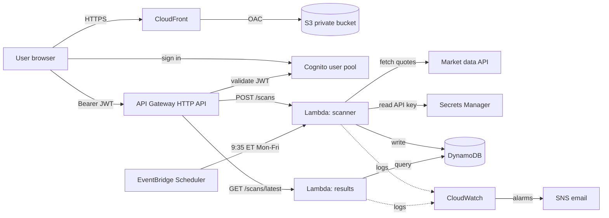
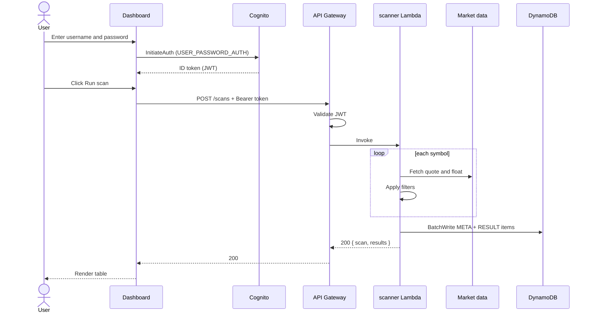
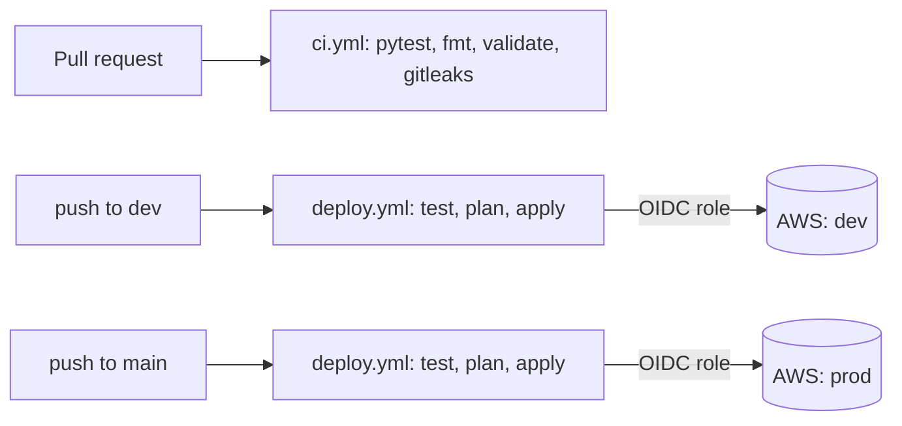

ProfitX Stock Scanner: Architecture Design Document

| | |
|---|---|
| **Project** | ProfitX AWS Serverless Stock Scanner |
| **Status** | v1 implemented (single-Lambda scanner). Fan-out design planned |
| **Repo** | `krkhalil2002/profitx-scanner-` |
| **Environments** | dev, prod (same Terraform code, separate state) |

---

## 1. Overview

ProfitX needs a way to find stocks that are "in play" at market open: stocks that gap up on unusually high volume with a small float. This system scans a list of tickers against deterministic rules, stores the matches, and shows them to authenticated users on a dashboard.

It is built entirely from AWS managed services (no EC2), defined as code in Terraform, and deployed through GitHub Actions.

## 2. Goals and Non-goals

**Goals**
- Filter symbols by gap %, volume, relative volume (RVOL), and float
- Store every scan with a timestamp so results can be retrieved later
- Let only authenticated users run scans and read results
- Run a scan automatically at market open on weekdays
- Deploy identically to dev and prod from code, with no console clicking
- Keep idle cost near zero and document the cost
- Log everything and alarm on failures

**Non-goals (for v1)**
- Real-time streaming quotes or intraday alerts
- Order execution or any trading action
- Machine-learning-based selection (rules are intentionally deterministic and explainable)
- Public sign-up or multi-tenant billing
- Scanning thousands of symbols per request (see section 10)

## 3. Requirements Traceability

| Requirement (project brief) | How it is met |
|---|---|
| Filter by gap %, volume, RVOL, float | `filters.py`, four thresholds, all must pass |
| Store results with timestamp | DynamoDB scan META item (`created_at`) plus result items |
| Authenticated retrieval | Cognito JWT authorizer on API Gateway |
| Deployable to dev and prod | One Terraform root module, `envs/dev.tfvars` and `envs/prod.tfvars` |
| Cost awareness documented | `docs/cost-breakdown.md` |
| Scheduled scans | EventBridge Scheduler, 9:35 AM Eastern, Mon to Fri |
| No console deployments, no hardcoded secrets | Terraform + GitHub Actions; Secrets Manager |
| Least-privilege IAM | One role per Lambda, resource-scoped policies |
| Logging | CloudWatch log groups (14-day retention), alarms |

## 4. High-Level Architecture



## 5. Components

| Component | Responsibility | Notes |
|---|---|---|
| **CloudFront + S3** | Serve the static dashboard | Bucket is private; CloudFront reads it through Origin Access Control. HTTPS enforced. Caching disabled (two tiny files) |
| **Cognito user pool** | Authenticate users, issue JWTs | Admin-created users only. 12+ character passwords. Browser client has no secret |
| **API Gateway (HTTP API)** | Public API, JWT validation, throttling | 10 req/s steady, burst 20. CORS restricted to the CloudFront origin |
| **Lambda: scanner** | Fetch data, apply filters, write results | Python 3.12, 256 MB, 25 s timeout. Triggered by API or Scheduler |
| **Lambda: results** | Return the latest scan | Python 3.12, 128 MB, 10 s timeout. Read-only |
| **DynamoDB** | Persist scans and results | On-demand, single table, TTL 30 days, point-in-time recovery in prod |
| **EventBridge Scheduler** | Trigger scheduled scans | Time-zone aware (`America/New_York`). Disabled in dev |
| **Secrets Manager** | Hold the market data API key | Terraform creates the empty secret; the value is set by CLI |
| **CloudWatch + SNS** | Logs, alarms, notifications | Alarms on Lambda errors and API 5xx. Optional email subscription |
| **AWS Budgets** | Cost guardrail | Emails at 80% of $5/month |
| **Terraform** | All infrastructure | Remote state in S3 with lockfile locking |
| **GitHub Actions** | Test and deploy | OIDC to AWS, no stored keys |

### Code layout

```
backend/functions/scanner/
  handler.py     Lambda entry point, input validation, DynamoDB writes
  filters.py     Pure scan rules (no AWS calls)
  providers.py   Market data providers (mock, FMP)
backend/functions/results/
  handler.py     Latest-scan query
```

The scan rules are kept as pure functions in their own module so they can be unit tested without any AWS dependency.

## 6. Data Design

### 6.1 Access patterns

| # | Pattern | Frequency |
|---|---|---|
| 1 | Get the most recent scan | Every dashboard load |
| 2 | Get all results for a scan | Every dashboard load |
| 3 | Write a scan summary and its results | Per scan |
| 4 | Expire old data automatically | Continuous |

Because the patterns are few and known in advance, DynamoDB fits well. Keys are designed from these patterns.

### 6.2 Table: `profitx-<env>-table`

| Attribute | Type | Purpose |
|---|---|---|
| `pk` | String (partition key) | `SCAN#<scan_id>` |
| `sk` | String (sort key) | `META` or `RESULT#<symbol>` |
| `gsi1pk` | String | Constant `SCANS`, set on META items only |
| `gsi1sk` | String | ISO timestamp, set on META items only |
| `expires_at` | Number | Epoch seconds; DynamoDB TTL attribute |

**Item types**

| Item | pk | sk | Attributes |
|---|---|---|---|
| Scan summary | `SCAN#a1b2c3d4e5f6` | `META` | `scan_id`, `created_at`, `triggered_by`, `scanned`, `matched`, `errors`, `filters`, `gsi1pk`, `gsi1sk` |
| Scan result | `SCAN#a1b2c3d4e5f6` | `RESULT#TSLA` | `symbol`, `price`, `gap_pct`, `volume`, `rvol`, `float` |

**How each pattern is served**

| Pattern | Operation |
|---|---|
| Latest scan | Query `gsi1` where `gsi1pk = "SCANS"`, descending, `Limit = 1` |
| Results of a scan | Query base table where `pk = SCAN#<id>` and `sk begins_with RESULT#` |
| Write a scan | `BatchWriteItem` of the META item plus result items |
| Expiry | TTL on `expires_at` (30 days after creation) |

Only META items carry the `gsi1` keys, so the index is small and holds exactly one entry per scan.

## 7. API Design

All endpoints require `Authorization: Bearer <Cognito ID token>`. API Gateway validates the token's signature, issuer, audience, and expiry before invoking any Lambda. Requests without a valid token receive `401` and never reach Lambda.

### POST /scans

Runs a scan immediately and returns the result.

**Request body (optional).** Any subset of the four filters, all numbers >= 0:

```json
{ "min_gap_pct": 6, "min_volume": 750000, "min_rvol": 2.5, "max_float": 30000000 }
```

**Response 200**

```json
{
  "scan": {
    "scan_id": "a1b2c3d4e5f6",
    "created_at": "2026-11-04T14:35:02.114+00:00",
    "triggered_by": "9f1c...-cognito-sub",
    "scanned": 40,
    "matched": 3,
    "errors": 0,
    "filters": { "min_gap_pct": 4, "min_volume": 500000, "min_rvol": 2, "max_float": 50000000 }
  },
  "results": [
    { "symbol": "TSLA", "price": 12.4, "gap_pct": 7.31, "volume": 1820000, "rvol": 3.12, "float": 22000000 }
  ]
}
```

**Response 400** for invalid input (unknown key, non-numeric value, negative value, malformed JSON):

```json
{ "error": "min_rvol must be a number" }
```

### GET /scans/latest

Returns the most recent scan and its matches, sorted by `gap_pct` descending. Same shape as the POST response. If no scan exists yet:

```json
{ "scan": null, "results": [] }
```

### Planned endpoints

`GET /scans`, `GET /scans/{scanId}`, and `/configs` (save, list, delete scan configurations). See section 16.

## 8. System Flows

### 8.1 Manual scan



### 8.2 Scheduled scan

EventBridge Scheduler invokes the scanner directly at 9:35 AM Eastern, Monday to Friday, with the payload `{"source": "schedule"}`. The scanner detects the absence of an API request context, uses the default filters, and records `triggered_by = "schedule"`. The dashboard shows these results the next time it loads `GET /scans/latest`.

### 8.3 Deployment



## 9. Security

**Authentication and authorization**
- Cognito issues JWTs; API Gateway enforces them before Lambda runs
- No public sign-up; an admin creates users
- The user's identity (`sub` claim) comes from the verified token, never from the request body

**IAM (least privilege)**

| Role | Allowed actions | Resources |
|---|---|---|
| scanner | `dynamodb:PutItem`, `BatchWriteItem` | The one table |
| | `secretsmanager:GetSecretValue` | The one secret |
| | `logs:CreateLogStream`, `PutLogEvents` | Its own log group |
| results | `dynamodb:Query` | The table and `gsi1` |
| | `logs:CreateLogStream`, `PutLogEvents` | Its own log group |
| scheduler | `lambda:InvokeFunction` | The scanner only |
| GitHub deploy | Broad (Terraform creates IAM and many services) | Limited by trust policy to this repo, `dev` and `main` branches |

**Data protection**
- DynamoDB and S3 are encrypted at rest with default AWS-owned keys
- HTTPS only on CloudFront and API Gateway
- S3 bucket is fully private with public access blocked
- Terraform state is in a versioned, private S3 bucket

**Secrets**
- The API key lives only in Secrets Manager. Terraform creates the empty secret so the key never lands in Terraform state or Git
- The Lambda environment holds the secret's ARN, not its value
- `gitleaks` scans pull requests for committed secrets

**Input validation**
- Filter keys are allow-listed; values must be numeric and non-negative

**Known gaps** (see section 15): broad CI role, no WAF, no per-user rate limiting beyond API-wide throttling.

## 10. Scalability and Performance

| Dimension | Current behavior | Limit and plan |
|---|---|---|
| **Users** | API Gateway and Lambda scale automatically | Throttle is 10 req/s; raise as needed. Cache `GET /scans/latest` if read traffic grows |
| **Symbols per scan** | Sequential fetches in one Lambda | Roughly 25 to 40 symbols per scan with a real API (two calls per symbol, 25 s limit). Beyond that, use the fan-out design below |
| **Storage** | On-demand DynamoDB, 30-day TTL | Effectively unbounded; cost grows with writes |
| **Cold starts** | Python 3.12, no third-party dependencies, clients created at module level | Typically hundreds of milliseconds on first call. Provisioned concurrency was rejected as not worth the cost |
| **Availability** | Multi-AZ managed services | Single region. Multi-region is out of scope |

**Target design for large symbol lists:** an orchestrator Lambda splits the list into batches, invokes worker Lambdas asynchronously in parallel, and records a job with a status. The API returns a job ID immediately and the dashboard polls. This removes the API Gateway timeout constraint and shortens scan time roughly in proportion to the number of workers.

## 11. Reliability, Observability, and Operations

**Logging.** Both Lambdas emit structured JSON log events (`scan_complete`, `results_read`) plus stack traces for failed fetches. Log groups are created by Terraform with 14-day retention.

**Alarms** (CloudWatch, notifying an SNS topic):
- scanner Lambda errors >= 1 in 5 minutes
- results Lambda errors >= 1 in 5 minutes
- API Gateway 5xx >= 1 in 5 minutes

**Failure handling**
- A failed fetch for one symbol is logged and counted in `errors`; the scan continues
- Symbols with missing or invalid data are skipped by the filters rather than raising
- Provider HTTP calls use an 8-second timeout

**Backups and recovery.** DynamoDB point-in-time recovery is enabled in prod. All infrastructure can be rebuilt from Terraform (`terraform destroy` then `apply`).

**Rollback.** Revert the commit and push; the pipeline redeploys the previous code.

**Testing.** pytest unit tests cover the filters (including threshold edges and bad data). Handler tests use `moto` to simulate DynamoDB.

## 12. Environments

| | dev | prod |
|---|---|---|
| Terraform vars | `envs/dev.tfvars` | `envs/prod.tfvars` |
| State key | `profitx/dev.tfstate` | `profitx/prod.tfstate` |
| Scheduled scan | Disabled | Enabled |
| DynamoDB PITR | Off | On |
| Deploy trigger | Push to `dev` | Push to `main` |

## 13. Cost

Estimated at roughly $1 to $2 per month with both environments deployed, dominated by Secrets Manager ($0.40 per secret per month). Lambda, API Gateway, DynamoDB, Cognito, CloudFront, and EventBridge sit in free tiers or round to pennies at this scale. See `docs/cost-breakdown.md` for assumptions, per-service estimates, and scale scenarios.

Cost controls: on-demand billing, 14-day log retention, API throttling, 30-day TTL, and an AWS Budget alert. Deliberately avoided: NAT Gateway, WAF, provisioned concurrency, customer-managed KMS keys, and RDS.

## 14. Key Design Decisions

| Decision | Chosen | Alternative | Why |
|---|---|---|---|
| Compute | Lambda | EC2 / containers | Bursty workload; pay per invocation; no servers to patch |
| Database | DynamoDB | RDS PostgreSQL | Simple key-based access; no idle cost; no instance to manage |
| Table design | Single table | One table per entity | Fewer reads, lower cost; keys derived from access patterns |
| API type | HTTP API | REST API | Cheaper, simpler, native JWT authorizer |
| API style | REST | GraphQL | Simple, consistent data needs |
| Auth | Cognito | Custom auth | Managed passwords, tokens, and brute-force protection |
| Scan execution (v1) | Synchronous | Asynchronous | Small symbol list fits the time limit; simpler |
| Scheduler | EventBridge Scheduler | Classic EventBridge rule | Time-zone support survives daylight saving |
| Secrets | Secrets Manager | Environment variables | Encrypted, IAM-controlled, rotatable |
| Frontend hosting | S3 + CloudFront | Server | No server cost; global CDN |
| IaC | Terraform | Console clicks | Repeatable, reviewable, identical environments |
| CI auth to AWS | GitHub OIDC | Stored access keys | Short-lived credentials; nothing to leak |
| Frontend auth flow | `USER_PASSWORD_AUTH` | SRP / hosted UI with PKCE | Simplest for a static page |
| Market data | Pluggable providers (mock, FMP) | Hard-coded provider | Develop for free; swap providers by editing one class |

## 15. Risks and Limitations

| Risk | Impact | Mitigation / next step |
|---|---|---|
| Market data API limits and float availability | Free tiers may rate-limit or lack float data | Provider interface isolates the change; mock provider for development; verify FMP field names before relying on it |
| Synchronous scan timeout | Large lists fail past ~30 s | Move to async fan-out |
| Broad CI deploy role | Compromise of the repo's `main` or `dev` branch could affect the AWS account | Tight OIDC trust; add scoped policy and a manual approval gate for prod |
| Direct password flow in browser | Less robust than SRP/PKCE | Move to hosted UI with PKCE |
| Single region | Regional outage means downtime | Acceptable for current scope |
| Scheduled scan fires at 9:35 AM ET even on market holidays | Wasted invocation, empty or stale data | Add a holiday check |
| No dead-letter queue | A failed scheduled run is only visible via the alarm | Add DLQ or on-failure destination |

## 16. Future Work

1. Orchestrator and parallel worker Lambdas with async job IDs and polling
2. Saved scan configurations (`/configs` endpoints, per-user storage)
3. `GET /scans` and `GET /scans/{scanId}` for history
4. React dashboard
5. Terraform modules per service
6. Shared Lambda layer for common utilities
7. Manual approval gate and scoped IAM for CI deploys
8. Dead-letter queues, market-holiday awareness, and a CloudWatch dashboard
9. AI-generated setup summaries (stretch goal)
chitecture-design-document.md…]()
